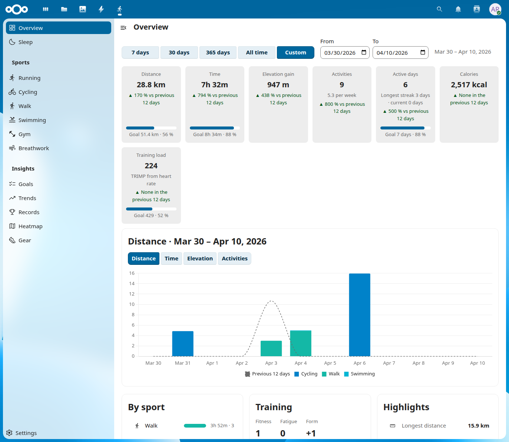
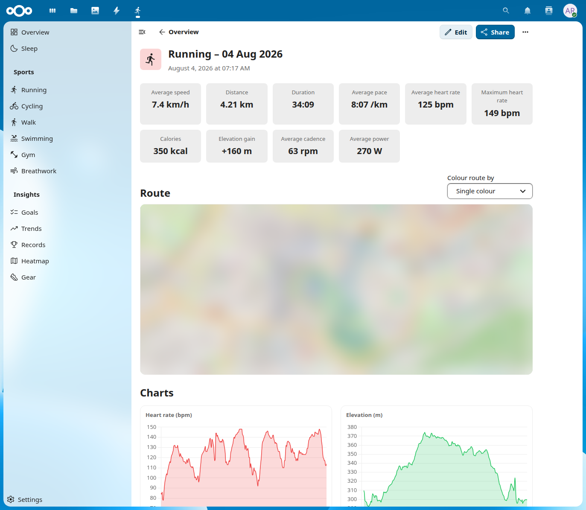
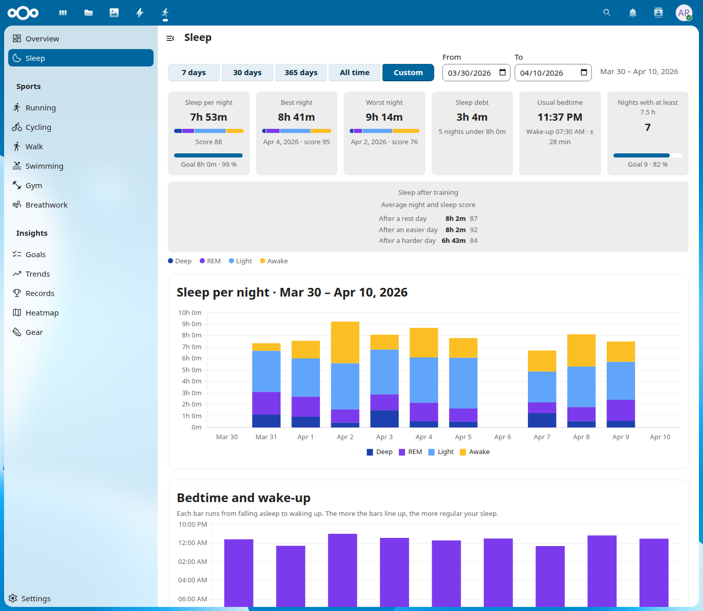
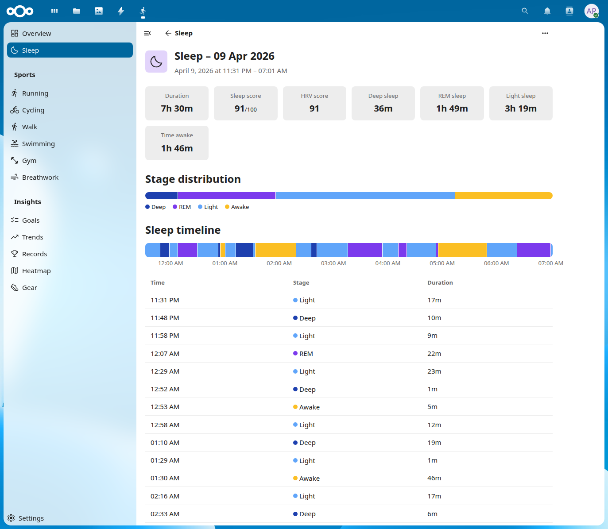

# FIT Tracker

A self-hosted Nextcloud app for tracking your fitness activities and sleep — powered by Garmin `.fit` files stored in your Nextcloud filesystem.

> ⚠️ **This app is vibe coded.**
>
> I am a developer, but I wanted to build something completly with AI. This project is a product of a chat with Claude AI, that lasted for a few hours. Except this few senteces here, everything is generated by AI. Even the rest of this readme.


## What it does

FIT Tracker scans a folder in your Nextcloud for `.fit` files exported from a Garmin device (or any device that produces standard FIT files) and automatically imports them into a database. It then presents your data in a clean dashboard with charts, maps, and detailed views.

### Overview

The first page is an **Overview** of a timeframe you choose: the last 7, 30 or 365 days, all time, or a custom range. Each sport in the navigation opens the same view for that sport, and the timeframe is kept when switching.

- **Totals:** distance, time, elevation gain, activities, active days with streaks, calories and training load, each compared with the previous timeframe of the same length
- **Goal progress** on each total, scaled to the timeframe (a weekly goal of 50 km is about 214 km over 30 days)
- **Chart** over the timeframe per day, week, month or year, split by sport, with the previous timeframe as a line
- **By sport, training** (fitness, fatigue, form and heart rate zones), **highlights** and **gear** due for replacement
- **Sleep** for the same timeframe (see below)
- **Activities** in the timeframe, with search and a distance filter

### Activities

- **Supported sports:** the full Garmin FIT sport list — Running, Cycling, Hiking, Walking, Swimming, Gym, Breathwork, Meditation, Skiing, and dozens more (sailing, golf, rowing, kayaking, tennis, climbing, ...). Sports without a dedicated icon still import with a generic icon
- **Sidebar navigation** only lists the sport types (and Sleep) you actually have data for
- **Detail view** per activity:
  - Key stats: distance, pace or speed depending on the sport, heart rate, elevation, calories, cadence, power
  - Map with the GPS route, coloured by speed, heart rate or elevation if you like, and linked to the charts on hover
  - Photos taken along the route: GPS-tagged JPEGs in your Nextcloud within 200 m of the track, as thumbnails and map pins, with a photo viewer
  - Charts for heart rate, elevation, pace or speed, and power
  - Heart rate zones and training load, splits per km or mile, laps, and power analysis (normalized power, intensity factor, TSS, power curve)
  - Weather at the start, if turned on in the settings
- **Edit** an activity's name, notes, perceived effort (1–10) and gear; these are kept when the file is imported again
- **Share** an activity as an image card, or as a public link with the route, stats and charts (the first and last 200 m of the route can be hidden)
- **"⋯" menu** on activity and sleep pages: **Re-import from file** reads the `.fit` file again; **Delete** removes the entry and moves its `.fit` file to the Nextcloud trash

### Sleep

- Garmin sleep and nap files are detected and kept apart from activities automatically
- **Sleep page** with the same timeframes as the Overview: sleep per night with score and stages, best and worst night, sleep debt, usual bedtime and wake-up, sleep after rest days and after easier or harder training days, a chart of sleep stages per night, bedtime regularity, weekdays against weekends, and the sleep sessions in the timeframe
- **Detail view** per night: duration, sleep score, HRV, time in each stage, and a timeline of every stage change through the night

### Insights

- **Goals:** weekly, monthly or yearly targets for distance, time, elevation, activities, active days, calories, training load, sleep per night, sleep score and nights with enough sleep, for all sports or one. The goals page shows which of the last weeks, months or years each goal was reached, and your streak
- **Trends:** year over year, fitness and fatigue over time, and time in heart rate zones per week
- **Records:** fastest times from 400 m to the marathon and over 5–100 km on the bike, best power from 5 seconds to an hour, and the longest distance, time and climb per sport
- **Heatmap:** every GPS route on one map, with the photos taken along them
- **Gear:** shoes, bikes and other gear with the distance put on them and a reminder when it is time to replace them. Gear can be the default for a sport from a start date, or be picked per activity

Also included: a **Nextcloud Dashboard widget** with this week's totals, the last sleep and recent activities, and optionally a **calendar event** for every activity.

### Settings

Open **Settings** at the bottom of the navigation:

- **Source folder:** choose any folder in your Nextcloud as the source for `.fit` files; it is saved right away
- **Sync now:** import new `.fit` files from the folder. This also happens automatically every time the app is opened, so you only need it after adding files while the app is open
- **Re-check sport types** reclassifies already-imported activities under the current sport detection logic, and moves any that turn out to be sleep/nap files over to Sleep
- **Re-import all files** removes all imported data and imports every `.fit` file in the folder again — useful after an update that improves file reading. Names, notes, gear and public links you added are kept
- **Units:** metric or imperial
- **Heart rate and power:** maximum and resting heart rate for zones and training load (by default the highest recorded heart rate and 60 bpm), and FTP for power analysis
- **Weather:** show the weather at the start of each activity, from [Open-Meteo](https://open-meteo.com/). Off by default; when on, the start location rounded to about 1 km and the date are sent to open-meteo.com
- **Calendar:** add every new activity as an event to one of your calendars, and add existing ones in one go
- **Public links:** see and delete all public activity links

---

## Screenshots

| Overview | Activity detail |
|----------|-----------------|
|  |  |

| Sleep | Sleep detail |
|-------|--------------|
|  |  |

---

## Tech stack

| Layer | Technology |
|-------|-----------|
| Platform | [Nextcloud](https://nextcloud.com) 32+ |
| Backend | PHP 8.1, Nextcloud OCP APIs |
| FIT parsing (activities) | [phpFITFileAnalysis](https://github.com/adriangibbons/php-fit-file-analysis) |
| FIT parsing (sleep) | Custom binary parser (messages 275 / 346 / 521) |
| Frontend | Vue 3 (Options API) + Vue Router |
| Charts | Chart.js 4 |
| Maps | Leaflet 1.9 |
| Nextcloud UI | @nextcloud/vue 9 |

---

## Installation

1. Clone or copy this repository into `<nextcloud>/apps/fit_tracker`
2. Install PHP dependencies:
   ```bash
   composer install --no-dev
   ```
3. Install JS dependencies and build:
   ```bash
   npm install
   npm run build
   ```
4. Enable the app in Nextcloud:
   - Go to **Apps → Your apps** and enable **FIT Tracker**, or run:
   ```bash
   php occ app:enable fit_tracker
   ```
5. Open FIT Tracker from the Nextcloud navigation bar, open **Settings** at the bottom of the navigation, and pick the folder containing your `.fit` files.

---

## How to get `.fit` files

- **Garmin Connect:** Go to an activity → ··· menu → Export Original
- **Garmin device directly:** Connect via USB, files are in `GARMIN/Activity/` and `GARMIN/Sleep/` (or similar paths depending on the device)
- Sleep files are usually named with a pattern like `G4A80020.fit` and are detected automatically — no manual sorting needed

---

## License

AGPL-3.0
