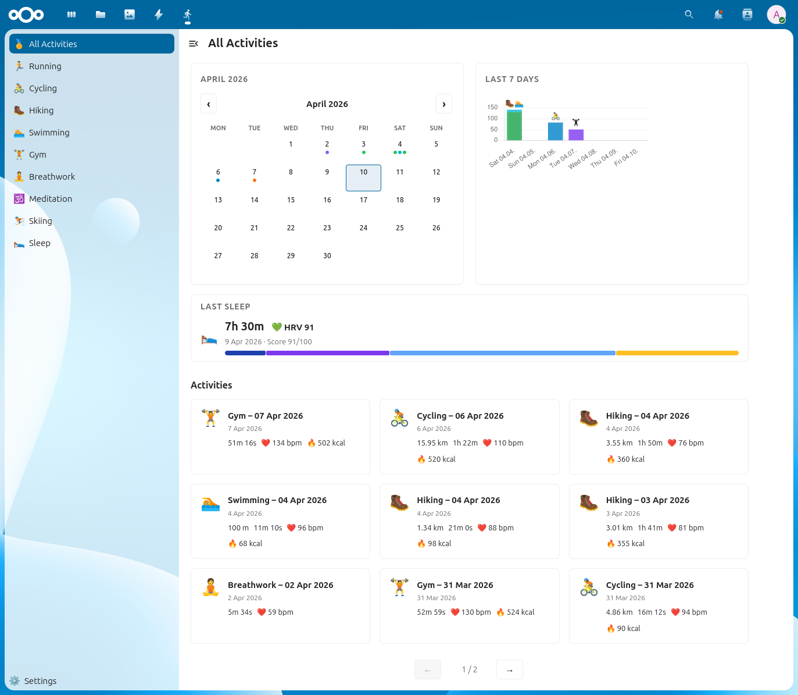
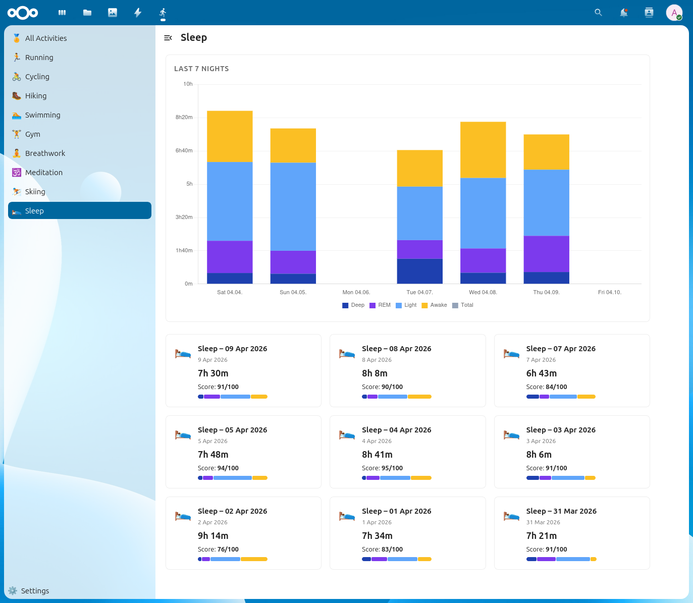

# FIT Tracker

A self-hosted Nextcloud app for tracking your fitness activities and sleep — powered by Garmin `.fit` files stored in your Nextcloud filesystem.

> ⚠️ **This app is vibe coded.**
>
> I am a developer, but I wanted to build something completly with AI. This project is a product of a chat with Claude AI, that lasted for a few hours. Except this few senteces here, everything is generated by AI. Even the rest of this readme.


## What it does

FIT Tracker scans a folder in your Nextcloud for `.fit` files exported from a Garmin device (or any device that produces standard FIT files) and automatically imports them into a database. It then presents your data in a clean dashboard with charts, maps, and detailed views.

### Activity tracking

- **Supported sports:** the full Garmin FIT sport list — Running, Cycling, Hiking, Walking, Swimming, Gym, Breathwork, Meditation, Skiing, and dozens more (sailing, golf, rowing, kayaking, tennis, climbing, ...). Sports without a dedicated icon still import fine with a generic icon and a title-cased label
- **Dashboard** for the last 7, 30 or 365 days, all time or a custom range: totals compared with the previous timeframe, progress on goals, a chart over the timeframe, training, highlights, gear, sleep and the activities in the timeframe. Each sport has the same dashboard
- **Sidebar navigation** only lists the sport types (and Sleep) you actually have imported activities for
- **Activity cards** display distance, duration, average heart rate, and calories
- **Share button** on the activity detail page generates a shareable image card (route map + key stats) for the activity
- **Detail view** per activity includes:
  - Key stats (distance, pace or speed depending on sport, heart rate, elevation, calories, cadence)
  - Interactive Leaflet map with GPS route and photo pins
  - Photos taken along the route, shown as a thumbnail strip and as clickable map pins for any activity with a GPS track — only GPS-tagged JPEG photos stored in Nextcloud are matched, within 200 m of the track. Clicking one opens a viewer with previous/next navigation
  - Charts for heart rate, elevation, power, and pace or speed (pace is shown Garmin-style: faster is up, m:ss values, stops dip to the bottom), plus average speed per km for running and cycling
  - Lap table with per-lap pace/speed, heart rate and distance
- **"⋯" menu** on activity and sleep detail pages:
  - **Re-import from file** reads the `.fit` file again with the current parser
  - **Delete** removes the entry and moves its `.fit` file to the Nextcloud trash; restoring the file imports it again on the next sync

### Sleep tracking

- Automatically detects and separates Garmin sleep `.fit` files from activity files
- Detected daytime naps are also imported as short sleep sessions
- **Sleep list** shows all recorded sleep sessions with a **monthly stacked bar chart** (Deep / REM / Light / Awake), with previous/next navigation between months
- **Dashboard widget** on the main activity page shows your last sleep session with duration, score, HRV and a stage distribution bar
- **Detail view** per sleep session includes:
  - Key stats: total duration, sleep score (0–100), HRV score, time in each stage
  - Stage distribution bar
  - Full sleep timeline — a coloured horizontal band showing every stage transition across the night with hour marks
  - Stage table with timestamps and per-stage duration

### Insights

- **Trends:** totals per week, month or year by sport, a year-over-year comparison, fitness / fatigue / form from heart rate training load (TRIMP), and time in heart rate zones per week
- **Records:** fastest times from 400 m to the marathon and over 5–100 km on the bike, best power from 5 seconds to an hour, and the longest distance, time and climb per sport
- **Heatmap:** every GPS route on one map, with the photos taken along them
- **Gear:** shoes, bikes and other gear with the distance put on them and a reminder when it is time to replace them. Gear can be the default for a sport from a start date, or be picked per activity
- **Goals:** weekly, monthly or yearly targets for distance, time, elevation, activities, active days, calories, training load and sleep. The dashboard scales them to the selected timeframe; the goals page shows which weeks, months or years they were reached
- **Activity details:** heart rate zones, splits per km or mile, power analysis (normalized power, intensity factor, TSS, power curve), route coloured by speed, heart rate or elevation, and charts linked to the map. Activities can be renamed and get notes, perceived effort and gear
- **Sharing:** besides the image card, a public link with the route, stats and charts; the first and last 200 m of the route can be hidden
- **Sleep trends:** averages, regularity of bed and wake times, weekday vs weekend, and how you sleep after rest days and harder training days
- **Nextcloud Dashboard widget** with this week's totals, the last sleep and recent activities

### Settings

Open **Settings** at the bottom of the navigation:

- **Source folder:** choose any folder in your Nextcloud as the source for `.fit` files; it is saved right away
- **Sync now:** import new `.fit` files from the folder. This also happens automatically every time the app is opened, so you only need it after adding files while the app is open
- **Re-check sport types** reclassifies already-imported activities under the current sport detection logic, and moves any that turn out to be sleep/nap files over to Sleep
- **Re-import all files** removes all imported data and imports every `.fit` file in the folder again — useful after an update that improves file reading. Names, notes, gear and public links you added are kept
- **Units:** metric or imperial
- **Heart rate and power:** maximum and resting heart rate for zones and training load (by default the highest recorded heart rate and 60 bpm), and FTP for power analysis
- **Weather:** show the weather at the start of each activity, from [Open-Meteo](https://open-meteo.com/). Off by default; when on, the start location rounded to about 1 km and the date are sent to open-meteo.com
- **Calendar:** add every new activity as an event to one of your calendars, and add existing ones in one go
- **Public links:** see and delete all public activity links

---

## Screenshots

<!-- Add your own screenshots here. Suggested captures:
     - Main dashboard (activity calendar + week chart + last sleep widget)
     - Activity detail with map and charts
     - Sleep list with monthly chart
     - Sleep detail with timeline
-->

| Dashboard | Activity detail |
|-----------|----------------|
|  |  |

| Sleep list | Sleep detail |
|------------|-------------|
|  |  |

---

## Tech stack

| Layer | Technology |
|-------|-----------|
| Platform | [Nextcloud](https://nextcloud.com) 32+ |
| Backend | PHP 8.1, Nextcloud OCP APIs |
| FIT parsing (activities) | [phpFITFileAnalysis](https://github.com/adriangibbons/php-fit-file-analysis) |
| FIT parsing (sleep) | Custom binary parser (messages 275 / 346 / 521) |
| Frontend | Vue 3 (Options API) + Vue Router |
| Charts | Chart.js 4 |
| Maps | Leaflet 1.9 |
| Nextcloud UI | @nextcloud/vue 9 |

---

## Installation

1. Clone or copy this repository into `<nextcloud>/apps/fit_tracker`
2. Install PHP dependencies:
   ```bash
   composer install --no-dev
   ```
3. Install JS dependencies and build:
   ```bash
   npm install
   npm run build
   ```
4. Enable the app in Nextcloud:
   - Go to **Apps → Your apps** and enable **FIT Tracker**, or run:
   ```bash
   php occ app:enable fit_tracker
   ```
5. Open FIT Tracker from the Nextcloud navigation bar, open **Settings** at the bottom of the navigation, and pick the folder containing your `.fit` files.

---

## How to get `.fit` files

- **Garmin Connect:** Go to an activity → ··· menu → Export Original
- **Garmin device directly:** Connect via USB, files are in `GARMIN/Activity/` and `GARMIN/Sleep/` (or similar paths depending on the device)
- Sleep files are usually named with a pattern like `G4A80020.fit` and are detected automatically — no manual sorting needed

---

## License

AGPL-3.0
